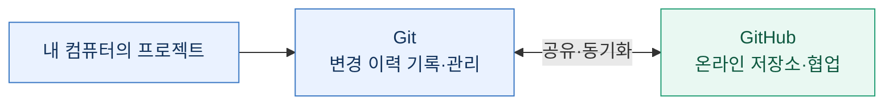
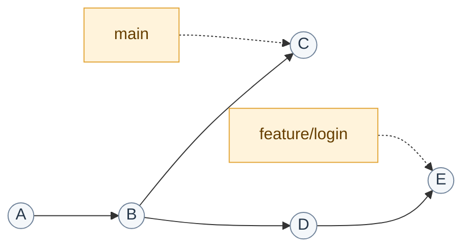
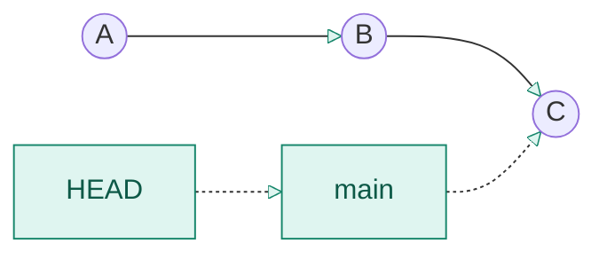
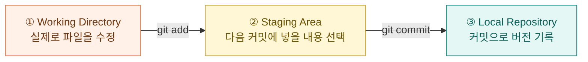
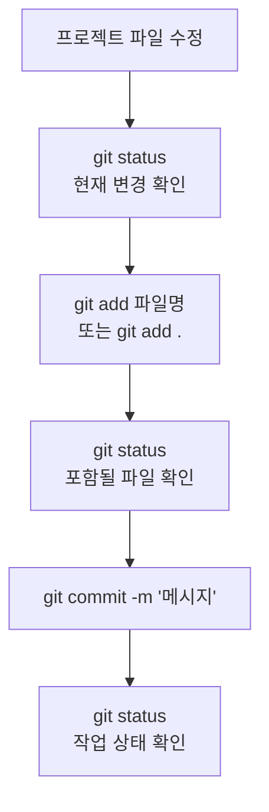
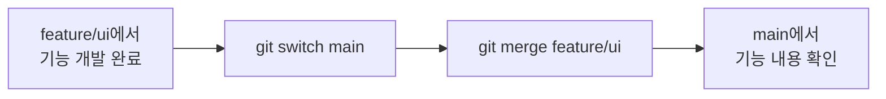
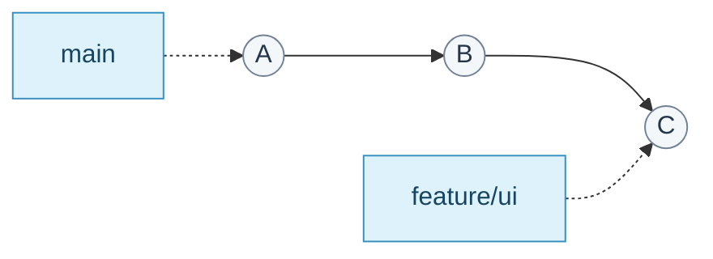
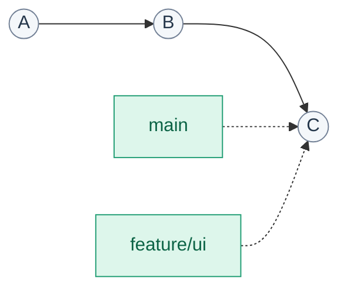

# Git & GitHub 1일차 기초 정리

## 핵심 요약

**Git은 변경 이력을 관리하는 도구이고, GitHub는 Git 저장소를 온라인에서 공유하고 협업하는 서비스**이다.



가장 많이 사용하는 작업 흐름은 다음과 같다.

**파일 수정 → `git add` → `git commit` → (필요하면) 브랜치 병합**

| 개념 | 한 문장으로 | 비유 |
|---|---|---|
| Repository | 프로젝트와 변경 이력을 관리하는 저장소 | 프로젝트 기록 창고 |
| Commit | 특정 시점의 변경을 기록하는 단위 | 게임 저장 지점 |
| Branch | 기존 작업에서 갈라져 나오는 개발 흐름 | 별도의 실험 경로 |
| HEAD | 현재 체크아웃된 위치를 나타내는 포인터 | 현재 작업 위치 표시 |
| Merge | 다른 브랜치의 작업을 현재 브랜치에 합침 | 갈라진 작업 합치기 |

> **핵심 문장:** `git add`는 **다음 커밋에 포함할 변경을 선택하는 단계**이고, `git commit`은 **스테이징한 내용을 버전으로 기록하는 단계**이다.

---

## 1. 버전 관리가 왜 필요할까?

### 1.1 버전 관리(Version Control)

파일의 **변경 이력을 체계적으로 기록하고 추적**하는 방법이다. Git을 사용하면 커밋 기록으로 **누가, 언제, 무엇을** 바꿨는지 확인할 수 있다. 변경 이유는 커밋 메시지 등을 통해 남길 수 있으며, 문제가 생겼을 때 이전 버전과 비교하거나 복구할 수 있다.

**버전 관리가 없는 상황**

```text
project/
├── final.py
├── final_v2.py
├── final_진짜최종.py
└── final_진짜최종_수정.py
```

파일만 복사하면 최신 버전, 변경 이유, 수정자를 확인하기 어렵다.

**Git을 사용하는 상황**

```text
프로젝트 파일: app.py (하나)
변경 기록: A(기본 기능) → B(로그인 추가) → C(버그 수정)
```

파일을 무한히 복사하는 대신 **커밋으로 변경 이력을 관리**한다.

### 1.2 Git과 GitHub의 차이

| 구분 | Git | GitHub |
|---|---|---|
| 정체 | 분산 버전 관리 도구 | Git 저장소를 호스팅하는 온라인 협업 서비스 |
| 주요 역할 | 변경 기록, 커밋, 브랜치, 병합 | 원격 저장소, 코드 공유, Pull Request, Issue, Review |
| 기본 사용 위치 | 내 컴퓨터에서도 단독 사용 가능 | 웹을 통한 공유와 협업에 활용 |
| 필요 관계 | GitHub 없이도 Git 사용 가능 | Git 기반 저장소를 호스팅 |

**기억법:** Git은 **버전 관리 엔진**, GitHub는 **코드 공유·협업 플랫폼**이다.

---

## 2. Git의 4가지 핵심 개념

### 2.1 Repository(레포지토리, 저장소)

**프로젝트 파일과 버전 기록을 함께 관리하는 곳**이다.
- **로컬 저장소(Local Repository):** 내 컴퓨터에 있는 Git 저장소
- **원격 저장소(Remote Repository):** GitHub와 같은 외부 서버에 있는 Git 저장소

현재 폴더를 Git 저장소로 만들려면 `git init`을 실행한다. 실행 후 `.git` 디렉터리에 Git의 관리 정보가 저장된다.

> **주의:** `git init`을 실행했다고 GitHub에 파일이 올라가는 것은 아니다. 로컬 저장소 생성과 온라인 업로드는 별개의 과정이다.

### 2.2 Commit(커밋)

커밋은 **선택한 변경 내용을 하나의 버전으로 기록**한다.

```bash
git commit -m "Add login API"
```
- 커밋마다 변경 이력과 메시지가 남는다.
- 어떤 작업을 했는지 나중에 찾고 비교하기 쉬워진다.
- 보통 **`git commit`을 실행하기 전에** `git add`로 변경 내용을 스테이징해야 한다.

### 2.3 Branch(브랜치)

브랜치는 **기존 개발 이력에서 독립적으로 이어지는 작업 흐름**이다. 로그인 기능을 개발하면서 `main`의 안정적인 상태를 유지할 때 유용하다.


- `main`과 `feature/login`은 B 커밋 이후 **서로 다른 작업 흐름**을 갖는다.
- 개발이 완료되면 브랜치의 변경을 `merge`로 합칠 수 있다.
- 브랜치는 폴더 복사본이 아니라 **특정 커밋을 가리키는 포인터**를 의미한다.

### 2.4 HEAD(헤드)

`HEAD`는 **지금 체크아웃해서 작업 중인 위치**를 나타낸다. 일반적인 경우 현재 브랜치를 가리키고, 그 브랜치는 최신 커밋을 가리킨다.



예를 들어 `git switch feature/login`을 실행하면 `HEAD`가 `feature/login` 브랜치를 가리키게 되어 작업 기준이 바뀐다. 다만 특정 커밋을 직접 체크아웃하는 **detached HEAD** 상태에서는 브랜치 대신 커밋을 직접 가리킬 수 있다.

---

## 3. Git에서 변경 내용이 저장되는 구조

다음 그림이 **Git 작업 흐름의 핵심**이다.



| 영역 | 하는 일 | 대표 동작 |
|---|---|---|
| Working Directory | 파일을 직접 수정하는 공간 | 코드 작성·수정·삭제 |
| Staging Area(인덱스) | **다음 커밋에 포함할 변경 사항**을 선택 | `git add` |
| Local Repository | 스테이징한 내용을 커밋으로 기록 | `git commit` |

### 예시: 로그인 기능을 추가했다면?

1. `login.py` 작성 → **Working Directory**에 변경이 생김

2. `git add login.py` → 파일의 현재 변경 내용이 **Staging Area**에 등록됨

3. `git commit -m "Add login feature"` → 등록된 내용이 **커밋으로 저장**됨

**혼동하기 쉬운 점**
- `git add`를 했다고 커밋이 완료된 것은 아니다.
- 스테이징 후 파일을 다시 수정하면, **새로 수정한 부분은 다시 `git add`해야** 커밋에 포함된다.
- `git commit`은 기본적으로 **스테이징된 내용**을 기록한다.

---

## 4. Git 설치 및 초기 설정

### 4.1 Git 설치 확인
- **Windows:** [Git for Windows](https://git-scm.com/downloads/win) 설치
- **macOS(Homebrew):** `brew install git`
- **GitHub 계정:** [github.com](https://github.com/)에서 생성

설치 후 터미널(VS Code 통합 터미널, PowerShell 등)에서 확인한다.

```powershell
git --version
```

### 4.2 커밋 작성자 설정

```powershell
# 모든 Git 저장소에 적용되는 전역 설정
git config --global user.name "Your Name"
git config --global user.email "you@example.com"
# 현재 설정 확인
git config --global --list
```

**특정 Git 저장소에서만** 이름이나 이메일을 다르게 지정하려면 해당 저장소 안에서 `--local` 옵션을 사용한다. 일반적인 Git 저장소 내부에서는 이 옵션을 생략해도 로컬 설정이 적용된다.

```powershell
# 현재 Git 저장소에만 적용하는 로컬 설정
git config --local user.name "Project Name"
git config --local user.email "project@example.com"

# 현재 저장소에서 실제로 적용되는 작성자 정보 확인
git config user.name
git config user.email
```

로컬 설정은 보통 해당 저장소의 `.git/config`에 저장되며, 동일한 항목에서는 전역 설정보다 우선한다.

> **보충:** `user.name`과 `user.email`은 **커밋 작성자 식별 정보**이다. 이것만 설정한다고 GitHub에 로그인되는 것은 아니다.

---

## 5. 로컬에서 Git 사용하기

### 5.1 필수 명령어

| 명령어 | 용도 | 언제 사용하나? |
|---|---|---|
| `git init` | 현재 폴더를 Git 저장소로 만들기 | 프로젝트 최초 설정 |
| `git status` | 변경·스테이징 상태 확인 | 작업 전후 수시로 |
| `git add 파일명` | 특정 파일의 변경을 스테이징 | 선택 커밋 |
| `git add .` | 현재 디렉터리와 하위 경로의 추가·수정·삭제를 스테이징 | 여러 변경을 함께 기록할 때 |
| `git commit -m "메시지"` | 스테이징된 변경을 커밋 | 작업 단위 완료 후 |



### 5.2 좋은 커밋 메시지 쓰기

원본 강의자료의 권장 원칙은 **명확·간결하게**, **동사로 시작**, **한 커밋에 한 작업**이다.

| 추천 | 비추천 |
|---|---|
| `Add login API` | `수정` |
| `Fix password validation bug` | `최종 수정 2` |
| `Refactor user service` | `여러 가지 변경` |

**중요한 이유:** 나중에 커밋 목록만 봐도 어떤 작업이 이루어졌는지 파악할 수 있다.

---

## 6. Branch(브랜치) 이해하기

### 6.1 왜 브랜치를 나눌까?
- `main`을 유지하면서 새로운 기능을 개발할 수 있다.
- 실험적인 변경을 메인 작업과 분리할 수 있다.
- 팀원들이 기능별로 작업한 뒤 필요한 시점에 합칠 수 있다.

### 6.2 브랜치 필수 명령어

```powershell
# 브랜치 목록 확인
git branch

# 방법 1: 생성 후 전환
git branch feature/ui
git switch feature/ui

# 방법 2: 생성과 전환을 한 번에 (방법 1 대신 사용)
git switch -c feature/ui
```

**주의:** 방법 1로 `feature/ui`를 이미 만들었다면 방법 2를 다시 실행하지 않는다. 같은 이름의 브랜치가 이미 존재하기 때문이다.

브랜치 목록에서 **별표(`*`)가 표시된 브랜치가 현재 브랜치**이다.

### 6.3 브랜치 관리 전략(강의자료 예시)

| 브랜치 | 목적 |
|---|---|
| `main` | 배포 가능한 안정 버전 |
| `dev` | 개발한 기능을 통합하고 테스트하는 버전 |
| `feature/*` | 새로운 기능 개발 |
| `hotfix/*` | 긴급 오류 수정 |

이는 **브랜치 관리 전략의 한 예시**이다. 모든 프로젝트가 이 네 종류의 브랜치를 반드시 사용해야 하는 것은 아니다.

---

## 7. `git merge`: 브랜치 병합하기

다른 브랜치의 작업을 **현재 체크아웃한 브랜치로 반영**하는 명령어이다.

```powershell
git switch main           # 병합 결과가 들어갈 브랜치로 이동
git merge feature/ui      # feature/ui의 변경을 main에 합침
```

**중요:** `git merge feature/ui`는 **`feature/ui`로 이동하는 명령이 아니라**, **현재 브랜치에 `feature/ui`를 합치는 명령**이다.



---

## 8. Fast-forward merge

### 8.1 Fast-forward merge: **브랜치 포인터만 앞으로 이동**

**조건:** 현재 브랜치(`main`)의 최신 커밋이 병합 대상 브랜치(`feature/ui`)의 **조상 커밋**인 경우이다. 즉, 기능 브랜치에서 작업하는 동안 `main`에는 독립적인 새 커밋이 추가되지 않은 상황이다.

**병합 전**


- A: 브랜치가 분리되기 전 공통 커밋
- B, C: `feature/ui`에서 만든 커밋
- `main`은 여전히 A에 머물러 있음

`main`에서 다음 명령을 실행하면:

```powershell
git switch main
git merge feature/ui
```

**병합 후**



**결과**
- `main`이 A에서 C로 **앞으로 이동**한다.
- 기본 동작에서는 **별도의 병합 커밋이 생성되지 않는다.**
- 기존 커밋 A → B → C가 그대로 일직선으로 유지된다.

> **한 문장 비유:** 다른 사람이 먼저 걸어간 길을 `main`이 **그대로 따라잡는 것**이다.

> **예외:** `git merge --no-ff feature/ui`처럼 `--no-ff` 옵션을 지정하면 Fast-forward가 가능한 상황에서도 병합 커밋을 생성할 수 있다.

---

## 9. 한눈에 보는 명령어 치트시트

| 단계 | 명령어 | 설명 |
|---|---|---|
| 설치 확인 | `git --version` | Git 설치 및 버전 확인 |
| 전역 작성자 설정 | `git config --global user.name "이름"` | 모든 저장소에 적용되는 작성자 이름 설정 |
| 전역 이메일 설정 | `git config --global user.email "이메일"` | 모든 저장소에 적용되는 작성자 이메일 설정 |
| 로컬 작성자 설정 | `git config --local user.name "이름"` | 현재 저장소에만 작성자 이름 설정 |
| 저장소 생성 | `git init` | 현재 폴더를 Git 저장소로 초기화 |
| 상태 확인 | `git status` | 변경 파일 및 스테이징 상태 확인 |
| 특정 파일 스테이징 | `git add 파일명` | 해당 파일의 변경 사항을 스테이징 |
| 현재 경로 스테이징 | `git add .` | 현재 디렉터리 이하의 변경 사항을 스테이징 |
| 커밋 생성 | `git commit -m "메시지"` | 스테이징한 내용을 커밋으로 기록 |
| 브랜치 목록 | `git branch` | 로컬 브랜치 목록 및 현재 브랜치 확인 |
| 브랜치 생성 | `git branch 브랜치명` | 새 브랜치 생성(전환하지 않음) |
| 브랜치 전환 | `git switch 브랜치명` | 지정한 브랜치로 전환 |
| 생성 및 전환 | `git switch -c 브랜치명` | 새 브랜치를 만들고 즉시 전환 |
| 브랜치 병합 | `git merge 브랜치명` | 지정한 브랜치를 현재 브랜치에 병합 |
| 이력 확인 | `git log --oneline --graph --decorate --all` | 브랜치 관계와 커밋 이력 확인 |


---

## 마무리: 이 다섯 문장만 기억하기

1. **Git**은 변경 이력을 관리하고, **GitHub**는 저장소 공유와 협업을 돕는다.

2. 코드를 수정한 뒤 **`git add`로 선택하고 `git commit`으로 기록**한다.

3. **Branch**는 독립된 작업 흐름이고, **HEAD**는 현재 작업 위치를 나타낸다.

4. **`git merge 대상브랜치`는 현재 브랜치에 대상 브랜치를 합치는 명령**이다.

5. **Fast-forward는 브랜치 포인터를 이동하는 병합**이다.
