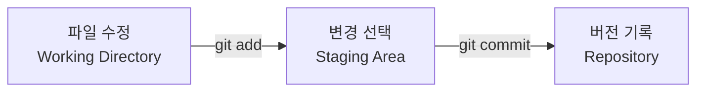
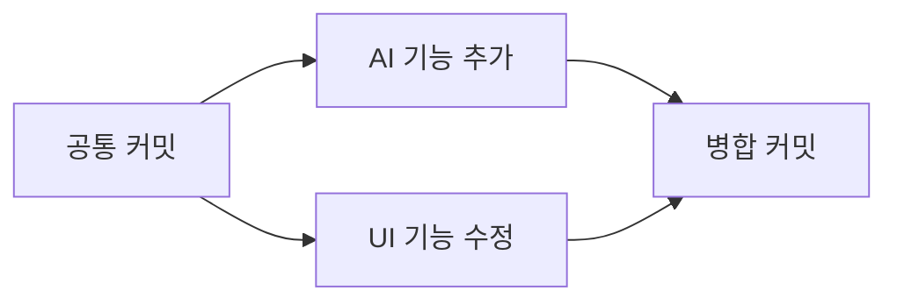

# Git & GitHub 2일차 학습일지

오늘은 어제 배운 Git 기본 개념을 실제로 사용해 봤다. 파일을 만들고 커밋하는 것부터 브랜치를 나누어 작업하고, 다시 합치는 과정까지 직접 실습했다. 특히 **Fast-forward merge와 일반적인 병합 커밋의 차이**, 그리고 **같은 파일을 서로 다르게 수정했을 때 충돌을 해결하는 방법**을 확인한 것이 핵심이었다.

## 1. 파일을 만들고 첫 커밋 남기기

먼저 Git 저장소를 초기화한 뒤 `api.py`, `hello.py`, `world.py` 파일을 만들었다. 파일을 수정했다고 바로 Git 기록에 남는 것은 아니므로, `git add`로 스테이징한 다음 `git commit`으로 하나의 버전을 저장했다.

```powershell
git init
git status
git add api.py hello.py world.py
git commit -m "Create files"
git log
```

여기서 기억할 점은 `git add`와 `git commit`이 서로 다른 역할을 한다는 것이다.

- `git status`: 현재 파일의 변경 상태 확인
- `git add`: 다음 커밋에 포함할 변경 내용 선택
- `git commit`: 선택한 변경 내용을 버전으로 기록
- `git log`: 지금까지 기록한 커밋 확인

파일을 수정한 **Working Directory**, 다음 커밋을 준비하는 **Staging Area**, 커밋 이력이 남는 **Repository**의 관계를 명령어로 연결해 볼 수 있었다.



## 2. 브랜치를 만들고 기능별로 작업하기

다음으로 `feat/ui` 브랜치를 만들어 `ui.py`를 추가하고, `main`으로 돌아와 병합했다.

```powershell
git branch feat/ui
git switch feat/ui
# ui.py 작성 후
git add ui.py
git commit -m "Create ui.py"
git switch main
git merge feat/ui
```

첫 병합은 **Fast-forward merge**로 진행되었다. `main`에는 그동안 별도의 새 커밋이 없었기 때문에, 새로운 병합 커밋을 만들지 않고 `main`이 UI 기능의 최신 커밋을 가리키도록 이동한 것이다.

이후에는 `feat/ai`에서 `ai.py`를 추가하고, `feat/ui`에서는 `ui.py`를 수정했다. 두 브랜치가 같은 커밋에서 출발해 각자 다른 커밋을 만들었고, `main`에 AI 작업을 먼저 합친 다음 UI 작업을 합쳤다. 이때는 서로 갈라진 이력을 통합하는 **병합 커밋(Merge commit)**이 만들어졌다.



**Fast-forward는 기존 커밋을 따라잡는 병합**이고, **갈라진 두 작업을 합칠 때는 별도의 병합 커밋이 생길 수 있다**는 차이를 실제 커밋 이력으로 확인했다. 브랜치는 폴더를 복사하는 기능이 아니라, 특정 커밋을 가리키는 포인터라는 설명도 이 과정에서 더 명확해졌다.

## 3. 같은 줄을 수정해 병합 충돌 해결하기

이번에는 의도적으로 충돌이 발생하도록 `left`와 `right` 브랜치를 만들었다. 두 브랜치 모두 `hello.py`의 같은 줄을 수정했지만 내용은 서로 달랐다.

```python
# left 브랜치
print("Hello, left")

# right 브랜치
print("Hello, right")
```

`main`에 `left`를 먼저 병합한 다음 `right`를 병합하는 과정에서, 서로 다른 변경을 어떻게 합칠지 정해야 했다. 최종적으로 두 메시지를 모두 반영하도록 파일을 수정하고 커밋했다.

```python
print("Hello, left & right")
```

```powershell
git switch main
git merge left
git merge right
# hello.py의 최종 내용 수정 후
git status
git add hello.py
git commit -m "Fix conflict"
```

충돌이 생기면 Git이 모든 내용을 자동으로 판단해 주는 것은 아니다. **충돌한 파일을 직접 확인하고, 원하는 최종 내용을 정한 뒤 다시 스테이징해야 병합을 마칠 수 있다.**

## 4. GitHub에 작업 결과 올리기

로컬에서 병합한 결과는 `git push`로 GitHub 원격 저장소에 올렸다.

```powershell
git push origin main
```

`origin`은 연결된 원격 저장소의 이름이고, `main`은 전송할 브랜치 이름이다. 로컬에서 커밋했다고 GitHub까지 자동으로 반영되는 것은 아니므로, **커밋과 Push는 별개의 과정**이라는 점도 확인했다.

실습 결과는 [GitHub 저장소](https://github.com/qhddn2643/oz-ai-08)에서 확인할 수 있다.

## 5. 오늘 배운 점

오늘 실습의 가장 큰 수확은 Git의 명령어를 각각 외우는 것보다 **커밋이 어떻게 연결되고 브랜치가 어디를 가리키는지 이해하는 것이 중요하다**는 점이다.

처음에는 `merge`를 단순히 파일을 합치는 명령으로 생각하기 쉽지만, 실제로는 커밋 이력의 관계에 따라 병합 결과가 달라진다. 또한 충돌이 생겼다고 작업이 실패한 것은 아니며, 필요한 내용을 선택하고 새로운 병합 커밋으로 정리할 수 있다는 것도 배웠다.

앞으로 팀 프로젝트에서 브랜치를 나눠 개발할 때, 작업 전에 어느 브랜치에 있는지 확인하고 커밋 단위를 명확하게 나누는 습관이 중요할 것 같다.

---

**한 줄 정리:** 오늘은 Git으로 파일을 기록하는 방법에서 한 걸음 더 나아가, 여러 브랜치의 작업을 안전하게 합치고 GitHub에 공유하는 흐름을 실습했다.
